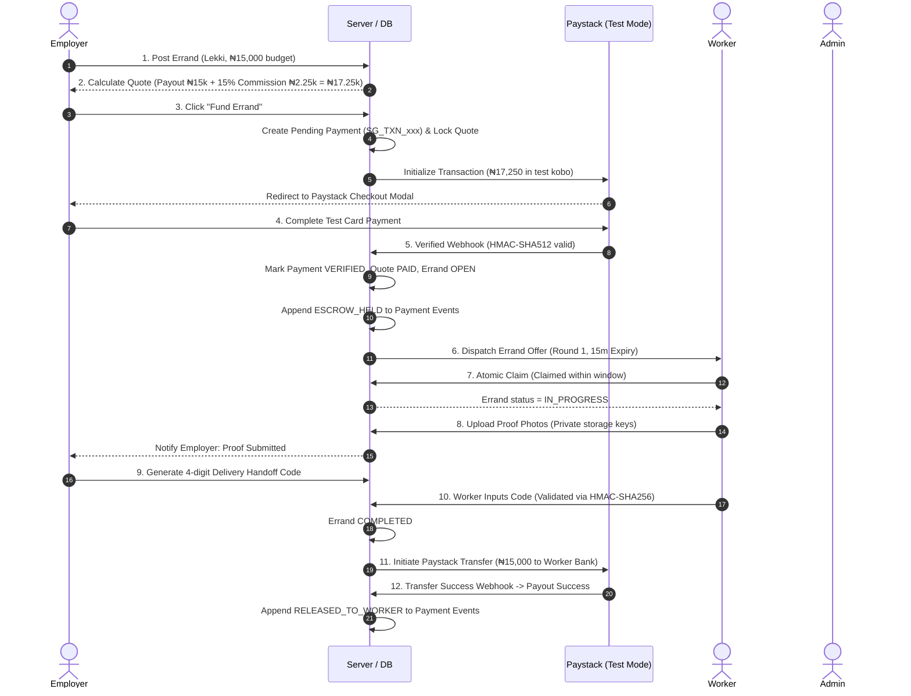
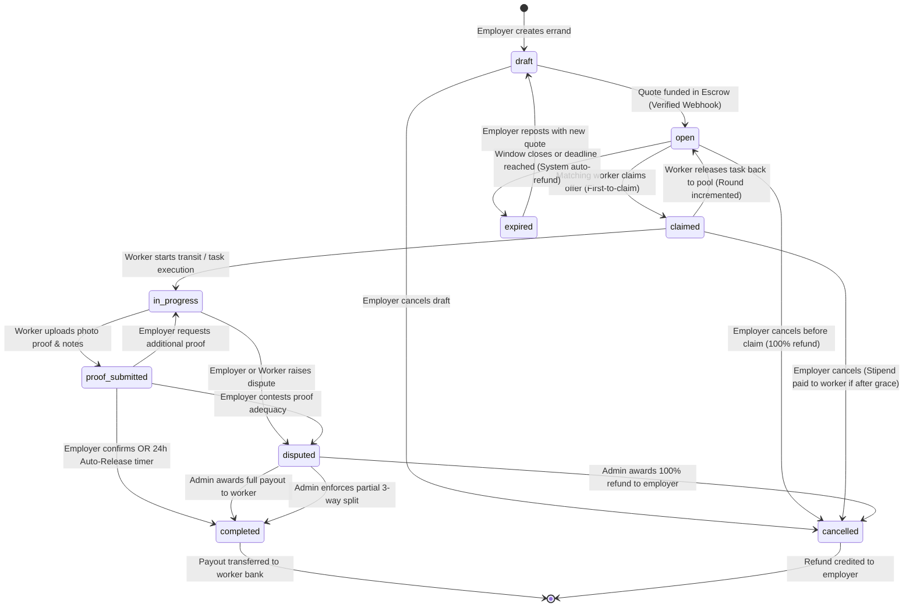
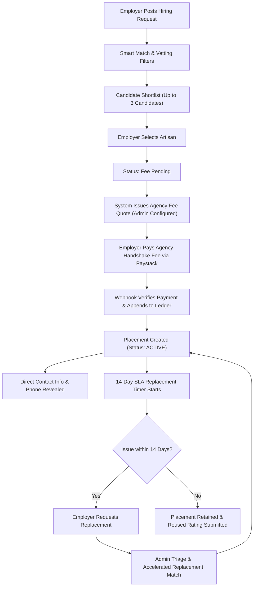
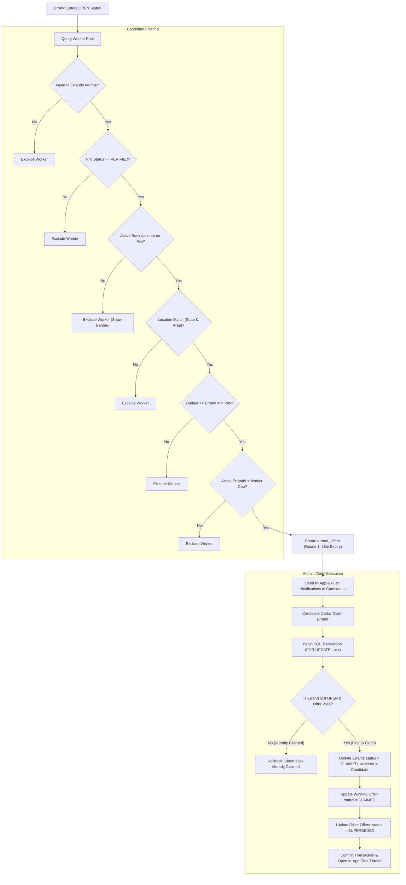
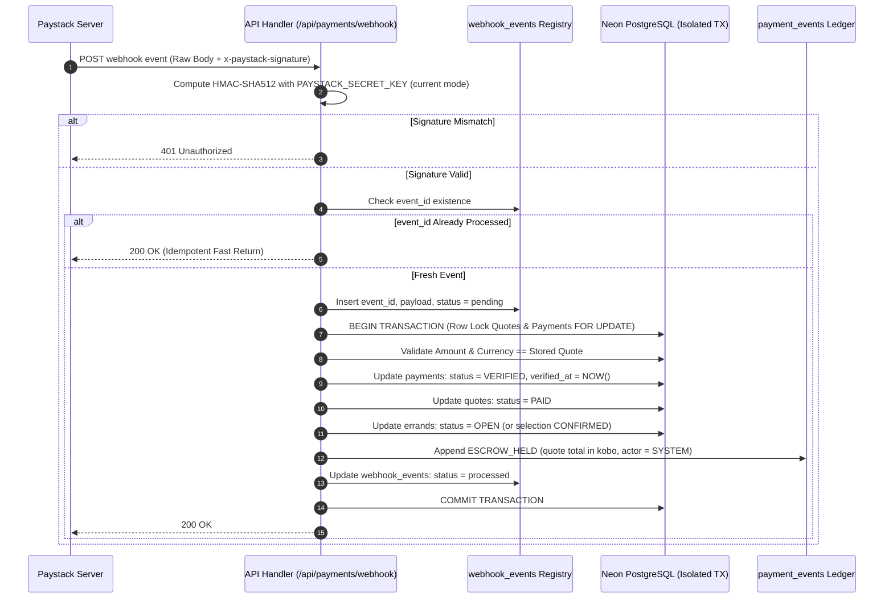
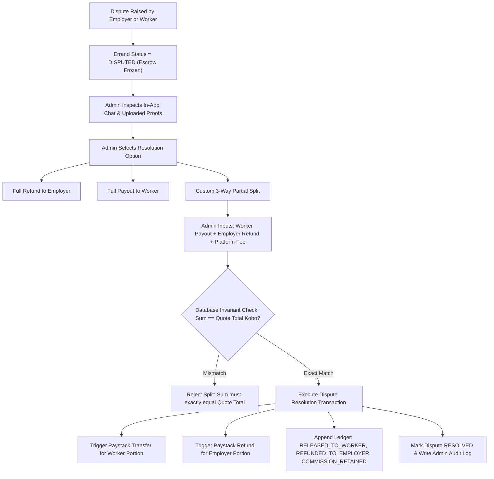
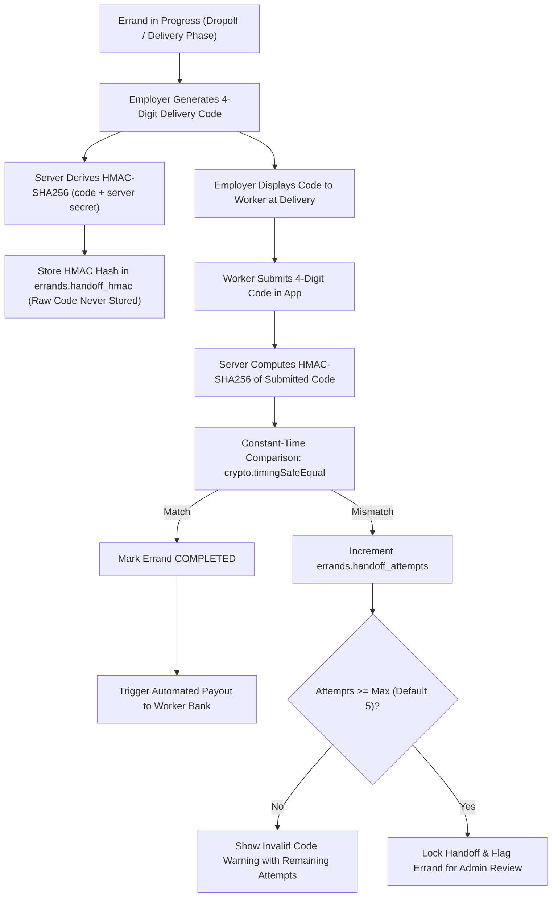

# Staff Guru — Master System Documentation & Architectural Blueprint

**Platform:** Staff Guru (Nigeria Talent Marketplace & Task Fulfillment Platform)  
**Verticals:** Full-Spectrum Job Matching (Any Job Role) + Alabaru (On-Demand Tasks & Errands)  
**Version:** 1.0.0 (Production-Ready V1 Baseline)  
**Database:** PostgreSQL (Neon Serverless) via Drizzle ORM  
**Architecture:** Monorepo (Turborepo + Next.js 15 PWA + Node.js + TypeScript)  
**Monorepo Health:** 52/52 Vitest unit tests passing | Monorepo builds green (`web` & `admin`)  

---

## 1. Executive Summary & Platform Vision

**Staff Guru** is a dual-vertical digital workforce infrastructure built specifically for the Nigerian economic context. It bridges the trust deficit between employers (both domestic and diaspora) and verified skilled talent through two distinct, tightly integrated engines:

```
                                  STAFF GURU PLATFORM
                                           │
         ┌─────────────────────────────────┴─────────────────────────────────┐
         ▼                                                                   ▼
┌─────────────────────────────────┐                         ┌─────────────────────────────────┐
│   FORMAL WORKFORCE MATCHING     │                         │       ALABARU ON-DEMAND         │
│   (ANY JOB ROLE / INDUSTRY)     │                         │       TASKS & ERRANDS           │
├─────────────────────────────────┤                         ├─────────────────────────────────┤
│ • Corporate, Domestic, Trades   │                         │ • Instant micro-task delegation │
│ • 100-point smart matching      │                         │ • Site inspection & photos      │
│ • Contact protection / redaction│                         │ • Pickup, queuing & purchasing  │
│ • Handshake agency fee          │                         │ • Fund-before-offer escrow      │
│ • 14-day SLA replacement track  │                         │ • Atomic first-to-claim engine  │
│ • Performance rating & review   │                         │ • HMAC-SHA256 delivery handoff  │
└─────────────────────────────────┘                         └─────────────────────────────────┘
```

1. **Formal Job Matching & Workforce Placement Marketplace (Any Job Role):**
   Designed for hiring talent across **any role or industry** — corporate professionals (accountants, executive assistants, receptionists, sales/marketing), domestic and estate staff (drivers, cooks, nannies, housekeepers, security), corporate technicians and artisans (electricians, plumbers, carpenters, site supervisors), retail/hospitality workers (cashiers, store managers, waitstaff), and field operators. Employers post structured hiring requests, receive algorithmically ranked candidate matches (top 3 shortlist), send Handshake offers, pay a regulated agency handshake fee, and receive the candidate's phone number only (never bank details or email) backed by a **14-day contractual SLA replacement guarantee**.

2. **Alabaru ("Tasks & Errands" Vertical):**
   Named after the trusted Yoruba market porter (*Alabaru*), this on-demand vertical allows diaspora and domestic employers to delegate critical, on-the-ground Nigerian tasks (photo inspections, document queuing, supervised market purchases, site verification, parcel delivery) to vetted, NIN-verified workers with bank accounts on file. Powered by a **single flat fee (70/30 split)**, 24-hour full refund if unclaimed, atomic concurrency locking, and encrypted 6-digit delivery handoff PINs.

---

## 2. Codebase Event Chronicle (Platform Evolution)

This chronicle details every architectural milestone, data model migration, and technical feature implemented across the Staff Guru codebase:

### Event 1: Turborepo Monorepo Architecture & Package Topology
- Configured a production-grade Turborepo monorepo with strict package boundaries:
  - `apps/web`: Next.js 15 React application serving the main landing page, public marketing, employer workspace, artisan portal, and onboarding wizards.
  - `apps/admin`: Dedicated Next.js 15 operational dashboard for marketplace administrators, verification triage, placement tracking, dispute settlement, and fee monitoring.
  - `packages/db`: Drizzle ORM schema, migrations, connection pools, and seed scripts connected to Neon PostgreSQL.
  - `packages/shared`: Zero-dependency domain libraries containing mathematical pricing formulas, 100-point matching algorithms, PII contact protection rules, actor-aware state machine transitions, and cryptographic helpers.
  - `packages/ui`: Design system tokens, typography rules, brand color palettes, and shared UI primitives.

### Event 2: Nigerian Brand Identity & UI Design System
- Created a tailored design language honoring Nigerian heritage and institutional authority:
  - Brand Palette: Nigerian Brand Green (`#008751`), Deep Forest Green (`#004d2e` / `#17342b`), Vibrant Accent Orange (`#e57200`), Forest Ink (`#152822`), and Warm Lagos Cream (`#FAF6EE`).
  - Typography: `Inter` for crisp UI readability + `DM Mono` for financial figures, kobo values, transaction codes, and timestamps.
  - Tactile Aesthetics: Fractal noise SVG grain (`.lp-grain`), 64px isometric grid backdrop (`.lp-grid`), continuous ticker marquees, and hover gloss sweeps (`.lp-shine`).
  - PWA Integration: Web app manifest (`manifest.webmanifest`), offline service worker (`sw.js`), custom application icons, and mobile safe-area insets.

### Event 3: Multi-Role Authentication & Onboarding
- Built a stateless JWT authentication engine using `jose` with secure HTTP-only cookies:
  - Role-Based Access Control (RBAC): `WORKER`, `EMPLOYER`, and `ADMIN`.
  - Dynamic Onboarding Wizards:
    - Employer: Captures business/individual type, hiring requirements, and operational location.
    - Worker: Captures category, technical skills, years of experience, expected pay, NIN identity reference, and the one-time **Alabaru Errand Opt-In** question (`openToErrands`).

### Event 4: 100-Point Algorithmic Job Matching Engine
- Implemented in `packages/shared/src/matching.ts` and `apps/web/src/server/services/matching.ts`:
  - Mathematical Scoring Rubric:
    - **Skills Match (40 pts):** Evaluates required skills (80% weighting) and preferred skills (20% weighting).
    - **Location Match (20 pts):** Uses Haversine geo-distance calculation (latitude/longitude) or Nigerian State/LGA string matching.
    - **Experience Match (15 pts):** Linear curve rewarding candidates meeting or exceeding required years.
    - **Availability Match (10 pts):** `AVAILABLE_NOW` vs `AVAILABLE_FROM` vs `BUSY`.
    - **Pay Match (10 pts):** Compares expected worker rate against employer budget.
    - **Trust & Verification (5 pts):** Awards points for NIN verification and past customer ratings.
  - Safe Candidate Preview: Redacts PII until an official connection/handshake occurs.
  - Dynamic Gap Explanations: Outputs plain-English match rationales and gap notices (e.g., *"Missing 1 required skill"*, *"Slightly above budget"*).

### Event 5: Handshake Protocol & Contact Protection
- Enforced strict platform contact protection (`packages/shared/src/contactProtection.ts`):
  - Automatically masks candidate phone numbers (`***-***-****`), emails (`***@***.***`), and NIN numbers until the employer completes a Handshake offer.
  - Handshake Creation (`apps/web/src/actions/handshake.ts`): Records a row in `selections` with status `PENDING` (or `fee_pending`), preventing premature off-platform circumvention.

### Event 6: Placement Lifecycle & 14-Day SLA Replacement Guarantee
- Modeled the formal placement lifecycle in `placements`:
  - When the employer pays the handshake fee, the selection status updates to `CONFIRMED` and creates an `ACTIVE` placement.
  - Starts a **14-Day SLA Replacement Guarantee Window**:
    - If a candidate abandons the role, underperforms, or violates terms within 14 days, the employer can trigger a replacement request (`replacementRequests`).
    - The Admin portal receives an urgent replacement ticket, prioritizing candidate matching without charging a second agency fee.
  - Removal Notices: Formal 14-day advance notice tracking (`removalNotices`) for orderly contract terminations.

### Event 7: Administrative Operations Suite (`apps/admin`)
- Built an operational control tower for marketplace administrators:
  - Worker Verification Queue: Triage pending artisans, review NIN details, and mark status `APPROVED` or `REJECTED`.
  - Hiring Requests & Fee Triage: Real-time visibility into open job orders and unpaid handshake fees.
  - Placement & Replacement Monitor: Real-time SLA tracker highlighting placements nearing the 14-day threshold.
  - Ratings Moderation: Content moderation view (`apps/admin/app/ratings`) ensuring customer feedback meets platform quality guidelines before public display.
  - Immutable Audit Feed: `audit_logs` tracking every administrative action with actor email, timestamp, and target entity.

### Event 8: Alabaru Tasks & Errands Architecture (Client-Approved Specification)
- Extended the marketplace to handle on-demand micro-tasks under a unified, client-specified model:
  - **Single Flat Fee & 70/30 Commission Split:** Errands use one flat fee (e.g. ₦10,000 total). There is no separate budget or creation fee. Staff Guru retains 30% platform commission (`errand_commission_basis_points = 3000` in `platform_settings`), with 70% net payout disbursed directly by Staff Guru to the worker's bank account on file.
  - **24-Hour 100% Refund Window:** If no runner claims the errand within 24 hours of creation, the employer receives an automatic 100% full refund of the flat fee.
  - **The 5 Locked Errand Categories:**
    1. Property inspection errands (`property_inspection`)
    2. Personal errands (`personal_errand`)
    3. Administrative errands (`administrative_errand`)
    4. Photography & media (`photography`)
    5. Pickup & delivery (`pickup_delivery`)
  - **Discovery & Eligibility Gating:** Accessible only via a dedicated dashboard page (`/dashboard/errands`) to workers who satisfy all claim guards: `openToErrands === true`, `ninVerificationStatus === 'VERIFIED'`, active bank account on file, and errand is funded.
  - **70/30 Commission Modal:** Displays the transparent breakdown: Flat Errand Fee, Staff Guru 30% Commission, and Worker 70% Take-Home payout to their bank account on file.
  - **In-App Messaging & Automated Redaction:** Errand-scoped chat thread (`errand_threads`, `errand_messages`) with automatic regex redaction of phone numbers, account numbers, and external URLs, backed by platform communication policy guidance.
  - **Cryptographic Delivery Handoff PIN:** 6-digit numeric code hashed server-side with HMAC-SHA256 and constant-time compared (`crypto.timingSafeEqual`) with settings-driven maximum attempts (`max_pin_attempts`, default 5).

### Event 9: Paystack Platform Fee Pipeline & Privacy Architecture
- Standardized the platform's financial mechanics around two clean, distinct streams:
  1. **Platform Fees via Paystack Gateway:** Employers pay Staff Guru platform fees (₦50,000 Handshake Agency Fee for formal job placements, Single Flat Fee for Alabaru errands) through Paystack test/live checkout.
     - Server-side transaction initialization with unique references (`SG_TXN_...`).
     - In-flight payment locking with `expiresAt = NOW() + 30m` on `payments` table.
     - Webhook processing with raw body HMAC-SHA512 signature verification (`PAYSTACK_SECRET_KEY`), idempotent deduplication (`webhook_events`), and rapid `200 OK` responses.
  2. **Privacy Invariants & Vertical-Specific Contact Rules:**
     - **Formal Job Placements (Phone-Only Reveal):** After agency fee verification, the employer unlocks the candidate's **phone number only**. Worker bank details are **NEVER** revealed to employers, and email is not revealed. The reveal happens strictly server-side, is rate-limited, audit-logged in `audit_logs`, and triggers an immediate notification to the worker. The direct-salary proof-of-payment flow is switched off (with a planned future migration to drop `direct_payment_proofs`).
     - **Alabaru On-Demand Errands (Payouts to Bank on File):** Bank details are collected exclusively for disbursing 70% errand earnings. Staff Guru executes the 70% payout directly to the worker's bank account on file upon verified task completion.
  - Manual "mark paid" capability restricted to authenticated administrators, logged as `source = 'manual'` with mandatory reasons and audit log entries.
  - Worker bank accounts validated offline via CBN NUBAN check digit algorithm without external API dependencies, and encrypted at rest using AES-256-GCM.

### Event 10: Clean-Slate Database Reset & Platform Seeding
- Executed full database truncation (`CASCADE`) removing all mock data, sample artisans, and fake job requests.
- Seeded the system administrator account (`admin@staffguru.com` / `AdminPassword123!`).
- Seeded the `platform_settings` parameters with labelled placeholders (`"placeholder, pending client decision"`).
- Verified that all unit tests pass and all monorepo applications compile without errors.

### Event 11: Phase 2.5 Privacy Invariants & Payment Hardening (Completed & Live)
- **Purged Bank Details from Employer Views:** Removed worker bank displays entirely from employer modals, candidate profile pages, and match cards. Deprecated `direct_payment_proofs` and turned off the direct salary proof flow.
- **Dedicated Contact Access Logging (`contact_access_logs`):** Created a generic actor access log (`actorId`, `actorRole`, `targetWorkerId`, `placementId`, `fieldAccessed = 'PHONE_NUMBER'`, `ipAddress`, `userAgent`, `createdAt`) instead of overloading admin audit logs.
- **Server Action `revealWorkerPhone`:** Authenticated server-side unlock that:
  1. Validates verified payment on the placement/selection.
  2. Enforces database rate limiting (maximum 5 reveals per 10 minutes per actor).
  3. Inserts an immutable access log in `contact_access_logs`.
  4. Delivers an in-app notification to the worker exactly once per placement; subsequent views are logged silently.
  5. Decrypts and returns phone number only (never reveals bank details, never email).
- **Payment Hardening & Neon DB Migration:** Applied migration `0005_phase2_5_contact_and_hardening.sql` adding partial unique indexes (`payments_verified_quote_idx`, `payments_verified_selection_idx`), preventing multiple verified payments per quote/selection. Hardened the Paystack webhook handler with late-payment handling for expired locks.

### Event 12: Phase 3 Worker Bank Onboarding for Errand Payouts (Completed & Live)
- **Conditional Onboarding Step:** Bank details step is displayed in the onboarding wizard **only if the worker chooses `openToErrands === true`**. Workers seeking formal jobs only skip this step completely.
- **Offline CBN NUBAN Check Digit Algorithm:** Instant client- and server-side validation using the Central Bank of Nigeria MOD 10 algorithm (`validateNuban`) across all major Nigerian banks.
- **AES-256-GCM Encryption:** Account numbers are encrypted at rest with per-record 12-byte IVs, 16-byte authentication tags, and key version tracking (`encryptField`, `decryptField`).
- **Masked Account Preview & Pending Consent:** Displays `•••• 5678` masked preview and includes consent text explicitly tagged `[PENDING CLIENT / LEGAL APPROVAL]`.
- **Targeted Dashboard Alert Banner:** Prompts only workers who have `openToErrands === true` and lack an active bank account on file.
- **Worker Profile Bank Screen (`/dashboard/profile/bank`):** Allows opted-in workers to manage their bank account on file. Updating an account enforces an automated 24-hour payout security hold (`payoutHoldUntil = NOW() + 24h`).
- **Standardized Terminology:** Enforced "bank account on file" universally across UI and server actions.

---

## 3. Database Architecture & Data Dictionary

Staff Guru's PostgreSQL database schema is maintained in `packages/db/src/schema.ts` and managed via Drizzle ORM.

### Complete Table Registry (30 Tables)

| Category | Table Name | Key Columns & Constraints | Description |
| :--- | :--- | :--- | :--- |
| **Auth & Core** | `users` | `id` (UUID), `email` (Unique), `passwordHash`, `role` (WORKER, EMPLOYER, ADMIN) | Core credentials and authorization roles. |
| **Auth & Core** | `worker_profiles` | `userId`, `category`, `skills` (text[]), `expectedPayKobo`, `status`, `ninVerificationStatus`, `openToErrands`, `errandPreferredAreas`, `errandMinPayKobo` | Artisan credentials, skills, verification status, and Alabaru preferences. |
| **Auth & Core** | `employer_profiles`| `userId`, `businessType` (CORPORATE, INDIVIDUAL), `businessName`, `location`, `hiringNeeds` | Client and corporate employer profiles. |
| **Auth & Core** | `portfolio_items` | `workerProfileId`, `title`, `imageUrl`, `description` | Artisan verified past project portfolio. |
| **Placements** | `hiring_requests` | `employerId`, `category`, `requiredSkills`, `budgetMinKobo`, `budgetMaxKobo`, `locationState`, `status` (OPEN, FILLED, CLOSED) | Employer job postings for artisan hiring. |
| **Placements** | `shortlists` | `hiringRequestId`, `createdAt` | Shortlist container for candidate matches. |
| **Placements** | `shortlist_items` | `shortlistId`, `workerProfileId` | Top matched candidates (up to 3). |
| **Placements** | `selections` | `employerProfileId`, `workerProfileId`, `hiringRequestId`, `status` (PENDING, CONFIRMED, CANCELLED) | Handshake offer linking employer and artisan. |
| **Placements** | `placements` | `selectionId` (Unique), `startDate`, `status` (ACTIVE, TERMINATED, REPLACED), `replacementDeadline` | Active formal contract with 14-day SLA deadline. |
| **Placements** | `replacement_requests`| `placementId`, `reason`, `dueAt` | Employer replacement ticket within 14-day SLA. |
| **Placements** | `removal_notices` | `placementId`, `noticeDate`, `reason` | Formal contract removal notices. |
| **Placements** | `ratings` | `placementId`, `errandId`, `score`, `feedback`, `moderated` (Exclusive check constraint) | Reused review table for placements and errands. |
| **Alabaru** | `errands` | `employerId`, `title`, `type`, `locationState`, `budgetKobo`, `status`, `claimedByWorkerId`, `handoffHmac`, `openedAt`, `claimedAt`, `completedAt` | Alabaru on-demand task records. |
| **Alabaru** | `quotes` | `selectionId`, `errandId`, `type`, `workerPayoutKobo`, `commissionKobo`, `totalKobo`, `status` (Exclusive check constraint) | Single source of truth for pricing calculations. |
| **Alabaru** | `errand_offers` | `errandId`, `workerProfileId`, `round`, `status`, `expiresAt` (Unique index on errand, worker, round) | Algorithmic offers dispatched to workers. |
| **Alabaru** | `errand_proofs` | `errandId`, `workerProfileId`, `photoKeys` (text[]), `notes`, `submittedAt` | Private photo keys proving errand completion. |
| **Alabaru** | `errand_disputes`| `errandId`, `raisedByUserId`, `quoteTotalKobo`, `workerPayoutKobo`, `employerRefundKobo`, `platformFeeKobo` (Check sum == total) | Dispute adjudication with strict 3-way split validation. |
| **Alabaru** | `errand_threads` | `errandId` (Unique), `employerId`, `workerProfileId` | In-app errand private chat thread. |
| **Alabaru** | `errand_messages`| `threadId`, `senderId`, `content`, `createdAt` | Individual messages within errand chat. |
| **Payments** | `payments` | `quoteId` (Unique), `provider`, `paystackReference`, `providerStatus`, `mode`, `source`, `manualReason`, `refundStatus`, `totalKobo` | Payment records across Paystack and manual fallbacks. |
| **Payments** | `payment_events` | `paymentId`, `eventType`, `amountKobo`, `actorType`, `actorId`, `metadata` | Append-only financial ledger. |
| **Payments** | `webhook_events` | `eventId` (Unique), `eventType`, `provider`, `payload`, `status` (pending, processed) | Idempotency registry for Paystack webhooks. |
| **Payments** | `worker_bank_accounts`| `workerProfileId`, `accountNumberEncrypted`, `accountNumberIv`, `accountNumberTag`, `keyVersion`, `accountNumberMasked`, `bankCode`, `bankName`, `accountName`, `accountNameResolved`, `paystackRecipientCode`, `isActive`, `payoutHoldUntil`, `deactivatedAt` | Encrypted bank accounts (AES-256-GCM) with offline NUBAN validation, non-gating resolved name, and replacement payout hold. |
| **Payments** | `payouts` | `workerProfileId`, `quoteId`, `amountKobo`, `transferReference`, `transferCode`, `status` (pending, processing, success, failed, reversed, needs_bank_fix), `retryCount` | Paystack Transfers payout ledger with retry handling and worker bank fix notification. |
| **Admin** | `platform_settings`| `key` (Unique), `value` (JSON), `label`, `description`, `updatedBy` | 12 admin-editable global settings. |
| **Admin** | `audit_logs` | `adminId`, `adminEmail`, `action`, `targetType`, `targetId`, `reason`, `metadata` | Immutable operational audit trail. |
| **Messaging**| `threads` | `employerId`, `adminId` | General employer-to-admin support threads. |
| **Messaging**| `messages` | `threadId`, `senderId`, `content` | Messages in general support threads. |
| **Messaging**| `notifications` | `userId`, `type`, `content`, `readAt` | Real-time in-app notification alerts. |
| **Messaging**| `push_subscriptions`| `userId`, `endpoint`, `keys` | Web Push PWA notification subscriptions. |

---

## 4. Algorithmic Job Matching Engine

The core value proposition of Staff Guru's formal placement vertical is its algorithmic matching system (`packages/shared/src/matching.ts`). Instead of requiring employers to sift through unvetted directories, the engine analyzes job requirements and candidate profiles across 6 weighted dimensions (0–100 total points):

$$\text{Match Score} = S_{\text{skills}} + S_{\text{location}} + S_{\text{experience}} + S_{\text{availability}} + S_{\text{pay}} + S_{\text{trust}}$$

```
MATCH SCORING BREAKDOWN (100 Points Total)
├── Skills (40 pts)       ─── Required Skills (32 pts) + Preferred Skills (8 pts)
├── Location (20 pts)     ─── Haversine distance curve (0-50km) or State/LGA match
├── Experience (15 pts)   ─── Linear scoring meeting or exceeding required years
├── Availability (10 pts) ─── AVAILABLE_NOW (10) | AVAILABLE_FROM (5-8) | BUSY (0)
├── Pay Alignment (10 pts)─── Expected daily/monthly rate vs employer budget range
└── Trust & Safety (5 pts)─── Verified NIN (3 pts) + Rating average (2 pts)
```

### Candidate Filtering & Privacy Guarantees
1. **Hard Constraints (SQL Layer):**
   - Candidate status must be `APPROVED` (never `REJECTED` or unreviewed `PENDING`).
   - Category must match the job order exactly.
   - Candidate cannot be currently deployed in an active placement or marked `BUSY`.
2. **Contact Protection:**
   - Candidate personal identifiable information (full phone number, email address, exact home street address) is masked with asterisks until the employer issues an official Handshake offer.
3. **Public Preview:**
   - Employers see verified technical skills, years of trade experience, anonymized location area (e.g., *"Lekki Phase 1, Lagos"*), NIN verification badges, and average customer star ratings.

---

## 5. Handshake Protocol, Contact Protection & 14-Day SLA

The transition from a candidate match to an on-the-ground hire is governed by the **Handshake Protocol**:

```
                       HANDSHAKE & PLACEMENT TIMELINE
                       
 Day 0                   Day 0 (Instant)         Day 0 to Day 14          Day 15+
   │                           │                        │                    │
   ▼                           ▼                        ▼                    ▼
[Handshake Offer] ──► [Pay Agency Fee] ──► [Placement ACTIVE] ──► [Permanent Placement]
Status: PENDING       Paystack Checkout    • Contact Unmasked     • Guarantee Concluded
                      ₦50,000 / Quote      • 14-Day SLA Starts    • Review & Rating
                                           • Replacement Window
```

1. **Offer Issuance:** The employer selects their preferred candidate from the shortlist. This creates a `selections` record with status `PENDING` (fee pending).
2. **Agency Fee Quote:** Staff Guru calculates an agency fee quote (default ₦50,000, configurable in `platform_settings`).
3. **Escrow / Fee Payment:** The employer pays the agency fee via Paystack.
4. **Placement Creation:**
   - Payment webhook marks the selection as `CONFIRMED`.
   - Creates an `ACTIVE` placement in `placements`.
   - Unmasks the artisan's direct phone number and contact details for the employer.
   - Sets `replacementDeadline = NOW() + 14 DAYS`.
5. **14-Day SLA Replacement Guarantee:**
   - If the candidate fails to report to work, exhibits misconduct, or lacks claimed skills within 14 days, the employer clicks **"Request Replacement"**.
   - Creates a `replacement_requests` ticket.
   - Staff Guru administrators prioritize matching and deploying a vetted replacement artisan without charging an additional agency fee.
6. **Orderly Termination Notice:** If either party wishes to end the engagement after the 14-day SLA, formal 14-day advance notice tracking (`removalNotices`) ensures an orderly handover.

---

## 6. Paystack Real Integration Architecture

All simulated payment pathways (`isDemo`, `DEMO_PAYMENT_SIMULATION_ENABLED`) have been expunged from the platform. The system operates on a single Paystack pipeline in **Test Mode** with server-side validation.

### Transaction Initialization & Webhook Ingestion Pipeline

1. **Server-Side Initialization:**
   - Quotes are calculated server-side using `@repo/shared` pricing logic.
   - The server creates a `payments` row in `PENDING` status with an expiry timestamp (`expiresAt = NOW() + 30m`) and a unique reference (`SG_TXN_` + UUID + timestamp).
   - The stored quote is locked against concurrent payment attempts or edits while a live pending payment row exists. Abandoned or expired payments release the lock, and retries generate a new unique reference.
   - Paystack's transaction initialize API (`POST https://api.paystack.co/transaction/initialize`) is invoked with the quote's exact `totalKobo`, employer email, and callback URL.

2. **Secure Webhook Ingestion (`POST /api/payments/webhook`):**
   - **Signature Verification:** Paystack signs webhooks using the account's standard Secret API Key. The raw binary request body is validated using HMAC-SHA512 against `PAYSTACK_SECRET_KEY` (for current test or live mode) from the `x-paystack-signature` header.
   - **Idempotency Guarantee:** The event is logged in `webhook_events` by `eventId`. If already present, a `200 OK` is returned immediately.
   - **Amount & Currency Validation:** The event payload amount and currency must match the stored quote `totalKobo` and `currency` exactly.
   - **Database Transaction & Quote State Transition:**
     - In an isolated SQL transaction with row locking (`FOR UPDATE`), payment is marked `VERIFIED`.
     - Quote transitions to `paid`.
     - Errand transitions to `open` (or hiring selection transitions to `CONFIRMED`).
     - A financial ledger entry `ESCROW_HELD` is appended to `payment_events`.
   - **Verify-Transaction Fallback:** If a webhook is delayed or dropped, the employer redirect page queries `GET /transaction/verify/:reference` within the same locking transaction.

3. **Admin "Mark Paid" Manual Fallback:**
   - Permitted only for authenticated administrators (`ADMIN` role).
   - Recorded strictly with `source = 'manual'`, `provider = 'manual'`, and a mandatory `manualReason`.
   - Automatically logged to `audit_logs` with admin email, timestamp, and target payment ID.

4. **Worker Payouts via Paystack Transfers:**
   - Non-blocking recipient creation via Paystack Create Transfer Recipient (`POST /transferrecipient`) in the background or at first payout attempt (never blocking onboarding).
   - If Paystack rejects an account as invalid, payout marks `needs_bank_fix`, notifies the worker, and retries automatically once updated.
   - If Paystack returns the resolved account name, it is stored in `accountNameResolved` and displayed on the admin payout screen only (strictly non-gating).
   - Automated payout initiation upon task completion or 24-hour auto-release.
   - Webhook handling for `transfer.success`, `transfer.failed`, and `transfer.reversed`.
   - Operational admin triage screen for stuck or failed transfers.

5. **Daily Reconciliation Job:**
   - Runs daily at 02:00 WAT.
   - Compares external Paystack transactions and transfers against internal `payments` and `payouts` rows.
   - Flags discrepancies in `audit_logs` and alerts system administrators.

---

## 7. End-to-End System Workflow Diagrams

### 7.1 Alabaru Errand Lifecycle & Escrow Settlement


### 7.2 Actor-Aware Errand State Machine

*Note: In-flight payment attempts do not alter quote status to `pending_payment`. Instead, an active row in `payments` with `expiresAt` locks the quote against concurrent attempts. If abandoned or expired, the lock releases automatically.*

### 7.3 Artisan Hire & Handshake Agency Placement Workflow


### 7.4 Algorithmic Matching & Atomic First-to-Claim Engine


### 7.5 Paystack Webhook Ingestion & Idempotent Ledger Pipeline


### 7.6 Dispute Adjudication & 3-Way Split Resolution


### 7.7 Cryptographic Delivery Handoff Verification


---

## 8. Legal & Regulatory Compliance Flags (Client Decision Required)

> [!WARNING]
> Please confirm the following three items with legal counsel and Paystack compliance before deploying V1 to production with live funds:

1. **Escrow Holding Permission:**
   - *Question:* Does holding employer funds in platform custody prior to task completion require a CBN (Central Bank of Nigeria) escrow or Payment Solution Service Provider (PSSP) license?
   - *Alternative:* Paystack Subaccounts with delayed split settlement vs direct platform merchant collection with Paystack Transfers payout.
2. **Refund Processing Fees:**
   - *Question:* Does Paystack return transaction processing fees (1.5% capped at ₦2,000) when a full or partial refund is issued to an employer?
   - *Action:* Determine whether the employer absorbs the Paystack fee on refund or whether the platform absorbs it.
3. **International Card Acceptance:**
   - *Question:* Are international credit/debit cards enabled on the Paystack merchant account to support diaspora employers funding errands from the UK, US, and Canada?
   - *Requirement:* Ensure 3D Secure (3DS) is mandated on all foreign transactions to mitigate chargeback exposure.
4. **Worker Bank Details Collection Consent Disclosure:**
   - *Status:* `[Pending Client or Legal Approval]`
   - *Consent Disclosure Text:* *"By providing your bank details, you authorize Staff Guru to securely store and share this information with CBN-licensed payment partners solely for automated task payout disbursement and regulatory compliance."*
   - *Action:* Confirm exact statutory wording required under the Nigeria Data Protection Act (NDPA 2023) and Central Bank of Nigeria (CBN) regulatory guidelines prior to public release.

---

## 9. Design System & Brand Identity Specification

Staff Guru utilizes a unified design system engineered in `packages/ui` and shared across `@staffguru/web` and `@staffguru/web-admin`.

### Brand Color Tokens (`packages/ui/src/tokens.ts` & CSS Variables)

| Token Name | Hex / Value | CSS Variable | UI Usage & Semantic Meaning |
| :--- | :--- | :--- | :--- |
| **Nigerian Brand Green** | `#008751` | `--ng`, `--green` | Primary call-to-action buttons, verified worker marks, official platform brand identity. |
| **Deep Forest Chrome** | `#004d2e` / `#17342b` | `--ng-deep`, `--sidebar` | Fixed navigation sidebar, modal headers, institutional high-contrast containers. |
| **Vibrant Accent Orange** | `#e57200` | `--ng-bright`, `--orange` | Urgent job tags, live activity ping dots (`.lp-pulse-dot`), alert banners, high-energy accents. |
| **Forest Ink** | `#152822` | `--ink`, `--foreground` | Primary text and headings. Provides rich, high-contrast readability without harsh pure black. |
| **Muted Forest Ink** | `#31443d` | `--ink-soft`, `--muted-foreground` | Subtitles, metadata lines, helper instructions, and disabled control labels. |
| **Dashboard Canvas** | `#f4f7f5` | `--canvas`, `--background` | Main application background. Neutral, calm, and distraction-free for high-focus task management. |
| **Warm Lagos Cream** | `#FAF6EE` / `#FAF5EB` | `--night`, `--night-2` | Marketing and public landing surfaces (`/find-work`, `/hire-talent`, `/terms`). Warm and welcoming. |
| **Lime Highlight** | `#d4f278` | `--lime` | Active navigation pills, badge counters, profile completion meters, and completion badges. |
| **Deep Lime Accent** | `#aacd4d` | `--lime-dark` | Borders and active states for lime elements on dark backgrounds. |
| **Clean White** | `#ffffff` | `--paper`, `--card` | Elevated card surfaces, job cards, popover dropdowns, and form input containers. |
| **Subtle Boundary Line** | `#e0e7e1` | `--line`, `--border` | 1px border dividers separating table rows, sidebar sections, and input boundaries. |

### Typography Hierarchy (`TYPOGRAPHY`)
- **Primary UI & Headings:** `Inter` (`--font-inter`, `sans-serif`)
  - **H1 Display Titles:** `font-weight: 600`, clamp(30px, 3.1vw, 41px), tight letter-spacing (`-1.8px`).
  - **Section Headings (H2/H3):** `font-weight: 600`, 18px–24px, letter-spacing (`-0.6px`).
  - **Body Text:** `font-weight: 400–500`, 13px–14px, line-height `1.55`.
- **Financial, Ledger & Cryptographic Data:** `DM Mono` (`--font-dm-mono`, `monospace`)
  - **Usage:** Currency totals (kobo conversions), transaction references (`SG_TXN_...`), handoff codes, Paystack transfer codes (`TRF_...`), timestamps, and badge counters.

### Responsive Layout System
- **Desktop (>=1100px):** 252px Fixed Forest Green Sidebar + 70px Topbar + 1380px max-width content container.
- **Tablet (821px–1100px):** 220px condensed sidebar with responsive grid collapse.
- **Compact Tablet (601px–820px):** 68px icon-only sidebar.
- **Mobile (<=600px):** Mobile brand bar + fixed frosted glass bottom navigation dock (`.mobile-nav`, `backdrop-filter: blur(14px)`).

---

## 10. Onboarding & End-to-End Testing Guide

Now that the database has been cleared of mock records, test the platform with fresh accounts using the following personas:

### Persona A: The Employer (Diaspora / Local Client)
- **Sign-Up URL:** `http://localhost:3000/signup`
- **Role:** `EMPLOYER`
- **Email:** `employer.test@example.com`
- **Password:** `TestPassword123!`
- **Onboarding Inputs (`/onboarding`):**
  - **Business / Client Name:** `Adebayo Properties Ltd`
  - **Location:** `Lekki Phase 1, Lagos`
  - **Category Needed:** `Construction & Facility Management`
  - **Description:** `Need a reliable supervisor and errand runner for site inspection.`
- **Features to Test:**
  1. Explore Employer Dashboard (`/employer`).
  2. Create a hiring request (`/employer/requests/new`) for an artisan.
  3. View matches returned by the 100-point algorithm.
  4. Post an Alabaru errand (Site photo inspection in Lekki Phase 1 with ₦15,000 budget).
  5. Confirm quote calculation: ₦15,000 payout + 15% commission (₦2,250) = ₦17,250 total.

### Persona B: The Worker / Artisan (Alabaru Runner)
- **Sign-Up URL:** `http://localhost:3000/signup`
- **Role:** `WORKER`
- **Email:** `worker.test@example.com`
- **Password:** `TestPassword123!`
- **Errand Opt-in Question:** Check **"Yes, I want to receive paid task & errand offers (Alabaru)"**.
- **Onboarding Inputs (`/onboarding`):**
  - **Category:** `Plumbing` (or `General Artisan`)
  - **Skills:** `Pipe fitting, Leak detection, Site inspection`
  - **Experience:** `5 years`
  - **Location:** `Lekki / Victoria Island, Lagos`
  - **Expected Daily Pay:** `₦12,000`
  - **NIN:** `12345678901` *(pending verification)*
- **Errand Preferences (`/dashboard/profile/edit`):**
  - **Open to Errands:** `true`
  - **Preferred States:** `Lagos`
  - **Preferred Areas:** `Lekki, Victoria Island, Ikoyi`
  - **Errand Types:** `Site Inspection`, `Pickup & Delivery`, `Queue & Document`
  - **Minimum Errand Pay:** `₦10,000`

### Persona C: The System Administrator
- **Login URL:** `http://localhost:3000/login`
- **Email:** `admin@staffguru.com`
- **Password:** `AdminPassword123!`
- **Admin Portal:** Accessible at `http://localhost:3001` or `/admin`
- **Features to Test:**
  1. Navigate to `/workers`.
  2. Review `worker.test@example.com` and approve their verification (mark NIN as `VERIFIED`).
  3. Inspect automated audit entries in `audit_logs`.
  4. Manage platform commission settings and handshake agency fees.
  5. Review active placements, replacement requests, and ratings moderation.

---

## 11. V1 Production Readiness Gap Analysis

| Domain | V1 Status | Production Readiness Checklist |
| :--- | :--- | :--- |
| **Database Schema** | **Production Ready** | All 30 tables, unique indexes, ledger tables, and enum definitions active in Neon PostgreSQL. |
| **Financial Engine** | **Production Ready** | 100% test coverage across pricing calculations, 12 platform settings, and kobo math. |
| **Security & Handoff** | **Production Ready** | HMAC-SHA256 delivery codes, brute-force locking, and contact protection (phone/email redact). |
| **Paystack Integration** | **Ready for Test Keys** | Add your Paystack test secret key to `apps/web/.env` and register the webhook URL. |
| **Email Verification** | **Pending API Key** | Connect Resend or Postmark API key in `apps/web/.env` for transactional activation emails. |
| **SMS / WhatsApp Verification** | **Pending API Key** | Connect Termii or Twilio API key for OTP delivery verification. |
| **NIN Verification** | **Pending Vendor** | Prembly (Identitypass) or Smile ID API integration to replace manual admin NIN triage. |
| **PWA & Mobile Support** | **Production Ready** | Web app manifest configured with custom icons and offline service worker. |

---

*Staff Guru Technical Architecture & Engineering Team*
