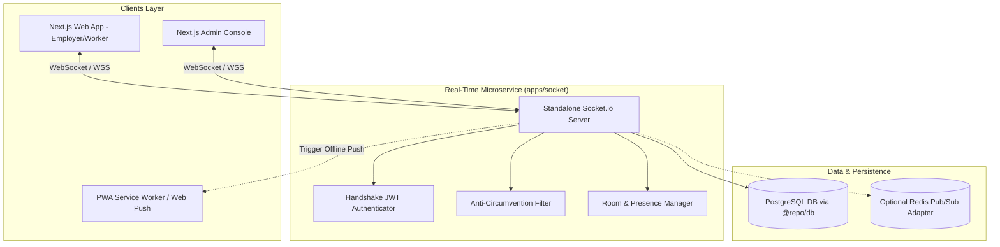

# Staff Guru In-App Real-Time Messaging Engine: Implementation Plan

## 1. Executive Summary & Architecture

Staff Guru requires an ultra-responsive, fault-tolerant real-time communication channel between **Employers** and **Runners** during active errand tasks, as well as live metric streams for the **Admin Console**.

Because Next.js deployed on Vercel is stateless and enforces execution timeouts (15–60s), long-lived persistent TCP connections must be terminated on a dedicated microservice.

### Architectural Blueprint



---

## 2. Monorepo Layout & Directory Structure

A new application workspace package will be added under `apps/socket`:

```
nigeria-marketplace/
├── apps/
│   ├── admin/                         # Admin Next.js web application
│   ├── web/                           # Main Next.js marketplace web application
│   │   └── src/
│   │       ├── hooks/
│   │       │   └── useErrandChat.ts   # Real-time chat client hook
│   │       └── providers/
│   │           └── SocketProvider.tsx # Global socket connection provider
│   └── socket/                        # [NEW] Standalone Socket.io service
│       ├── package.json
│       ├── tsconfig.json
│       ├── Dockerfile
│       └── src/
│           ├── index.ts               # HTTP & Socket.io server bootstrap
│           ├── auth.ts                # Handshake token verification
│           ├── handlers/
│           │   ├── chatHandler.ts     # Errand room messaging logic
│           │   ├── presenceHandler.ts # Online/offline tracking
│           │   └── adminHandler.ts    # Admin live metric broadcasting
│           └── lib/
│               └── antiCircumvention.ts # Contact masking gate
├── packages/
│   ├── db/                            # Shared Drizzle ORM schema
│   └── shared/                        # Shared types and validation schemas
```

---

## 3. Database Schema Refinements (`packages/db`)

Update `errand_messages` in `packages/db/src/schema.ts` to support delivery confirmations, read receipts, and multimedia proofs:

```typescript
// packages/db/src/schema.ts

export const errandMessages = pgTable("errand_messages", {
  id: uuid("id").primaryKey().defaultRandom(),
  threadId: uuid("thread_id").references(() => errandThreads.id).notNull(),
  senderId: uuid("sender_id").references(() => users.id).notNull(),
  content: text("content").notNull(),
  attachmentUrl: text("attachment_url"),
  status: text("status").default("sent").notNull(), // 'sending' | 'sent' | 'delivered' | 'read'
  deliveredAt: timestamp("delivered_at"),
  readAt: timestamp("read_at"),
  createdAt: timestamp("created_at").defaultNow().notNull(),
});
```

---

## 4. Socket Event Contract

All socket payloads are validated with Zod before processing.

### Room Addressing Schemes
- **`errand:${errandId}`**: Scoped to the specific employer and assigned runner.
- **`user:${userId}`**: Personal notification channel (unread counts, incoming task pings).
- **`admin:stream`**: Broadcast channel for admin portal live-sync.

### Event Definitions

| Direction | Event Name | Payload | Description |
| :--- | :--- | :--- | :--- |
| **Client → Server** | `chat:join` | `{ errandId: string }` | Client joins an errand room after access check. |
| **Client → Server** | `chat:leave` | `{ errandId: string }` | Client leaves the errand room. |
| **Client → Server** | `chat:send` | `{ errandId: string, content: string, tempId: string, attachmentUrl?: string }` | Client dispatches a message. |
| **Server → Client** | `chat:new` | `{ id: string, errandId: string, senderId: string, content: string, createdAt: string, tempId?: string }` | Broadcast to all room members. |
| **Client → Server** | `chat:typing` | `{ errandId: string, isTyping: boolean }` | Broadcasts typing state to counterparty. |
| **Server → Client** | `chat:typing_update` | `{ userId: string, isTyping: boolean }` | Informs counterparty of active typing. |
| **Client → Server** | `chat:mark_read` | `{ errandId: string, messageIds: string[] }` | Marks messages as read by receiver. |
| **Server → Client** | `chat:read_receipt` | `{ errandId: string, readByUserId: string, readAt: string }` | Notifies sender of read receipt. |

---

## 5. Security & Anti-Circumvention Pipeline

To safeguard platform escrow and protect users from fraud:
1. **Double-layer Contact Redaction:** Every incoming `chat:send` event passes through the leetspeak and NUBAN scanner (`redactContactInformation`) before database insertion.
2. **Access Control:** Sockets can only join `errand:${errandId}` if their decoded `userId` matches the errand's `employerId` or the assigned runner's `workerProfileId`.
3. **Escrow Status Gating:** Free chat is only enabled when errand status is `in_progress`, `revision_requested`, or `disputed`. Once completed or cancelled, chat enters read-only mode.

---

## 6. Client Implementation Plan (`apps/web`)

### A. Global Socket Provider (`SocketProvider.tsx`)
```tsx
// apps/web/src/providers/SocketProvider.tsx
"use client";

import React, { createContext, useContext, useEffect, useState } from "react";
import { io, Socket } from "socket.io-client";

interface SocketContextValue {
  socket: Socket | null;
  isConnected: boolean;
}

const SocketContext = createContext<SocketContextValue>({ socket: null, isConnected: false });

export function SocketProvider({ children, token }: { children: React.ReactNode; token?: string }) {
  const [socket, setSocket] = useState<Socket | null>(null);
  const [isConnected, setIsConnected] = useState(false);

  useEffect(() => {
    const wsUrl = process.env.NEXT_PUBLIC_SOCKET_URL || "http://localhost:4000";
    const s = io(wsUrl, {
      auth: { token },
      transports: ["websocket", "polling"],
      reconnectionAttempts: 10,
      reconnectionDelay: 1000,
    });

    s.on("connect", () => setIsConnected(true));
    s.on("disconnect", () => setIsConnected(false));
    setSocket(s);

    return () => {
      s.disconnect();
    };
  }, [token]);

  return (
    <SocketContext.Provider value={{ socket, isConnected }}>
      {children}
    </SocketContext.Provider>
  );
}

export const useSocket = () => useContext(SocketContext);
```

### B. Custom Chat Hook (`useErrandChat.ts`)
```tsx
// apps/web/src/hooks/useErrandChat.ts
"use client";

import { useEffect, useState, useCallback, useRef } from "react";
import { useSocket } from "@/providers/SocketProvider";

export function useErrandChat(errandId: string, initialMessages: any[], currentUserId: string) {
  const { socket, isConnected } = useSocket();
  const [messages, setMessages] = useState(initialMessages);
  const [isCounterpartTyping, setIsCounterpartTyping] = useState(false);
  const typingTimeoutRef = useRef<NodeJS.Timeout | null>(null);

  useEffect(() => {
    if (!socket || !isConnected) return;

    socket.emit("chat:join", { errandId });

    socket.on("chat:new", (msg: any) => {
      setMessages((prev) => {
        // Reconcile optimistic message
        if (msg.tempId) {
          return prev.map((m) => (m.id === msg.tempId ? msg : m));
        }
        return [...prev, msg];
      });
      // Mark read automatically if viewing
      socket.emit("chat:mark_read", { errandId, messageIds: [msg.id] });
    });

    socket.on("chat:typing_update", ({ userId, isTyping }: any) => {
      if (userId !== currentUserId) {
        setIsCounterpartTyping(isTyping);
      }
    });

    return () => {
      socket.emit("chat:leave", { errandId });
      socket.off("chat:new");
      socket.off("chat:typing_update");
    };
  }, [socket, isConnected, errandId, currentUserId]);

  const sendMessage = useCallback((content: string) => {
    if (!socket) return;
    const tempId = `temp_${Date.now()}`;
    const optimisticMsg = {
      id: tempId,
      tempId,
      senderId: currentUserId,
      content,
      createdAt: new Date().toISOString(),
      status: "sending",
    };
    setMessages((prev) => [...prev, optimisticMsg]);
    socket.emit("chat:send", { errandId, content, tempId });
  }, [socket, errandId, currentUserId]);

  const sendTyping = useCallback((isTyping: boolean) => {
    if (!socket) return;
    socket.emit("chat:typing", { errandId, isTyping });
  }, [socket, errandId]);

  return {
    messages,
    sendMessage,
    sendTyping,
    isCounterpartTyping,
    isConnected,
  };
}
```

---

## 7. Deployment Configuration

### Dockerfile for `apps/socket`
```dockerfile
FROM node:20-alpine AS builder
WORKDIR /app
RUN npm install -g pnpm turbo
COPY . .
RUN turbo prune @staffguru/socket --docker

FROM node:20-alpine AS runner
WORKDIR /app
COPY --from=builder /app/out/json/ .
COPY --from=builder /app/out/pnpm-lock.yaml ./
RUN npm install -g pnpm && pnpm install --frozen-lockfile --prod

COPY --from=builder /app/out/full/ .
RUN pnpm --filter @staffguru/socket build

ENV PORT=4000
ENV NODE_ENV=production
EXPOSE 4000

CMD ["node", "apps/socket/dist/index.js"]
```

### Environment Variables
- `PORT`: `4000`
- `DATABASE_URL`: `postgres://...` (Connection pool to Supabase / RDS)
- `JWT_SECRET`: Shared encryption key for validating user sessions
- `CORS_ORIGIN`: `https://staffguru.ng, https://admin.staffguru.ng`
- `REDIS_URL`: (Optional) `redis://...` for horizontal clustering

---

## 8. Rollout Plan

1. **Step 1: Package Scaffold:** Initialize `apps/socket` in Turborepo with Fastify & Socket.io.
2. **Step 2: Database Migration:** Add `read_at` and `status` to `errand_messages`.
3. **Step 3: Web Client Integration:** Wire `useErrandChat` into `EmployerErrandDetailClient.tsx` and `WorkerErrandDetailClient.tsx`.
4. **Step 4: Push Notification Bridge:** Trigger background push notification if recipient socket is not active in the room.
5. **Step 5: Staging Deployment:** Deploy `apps/socket` to Railway/Render and connect staging web client.
